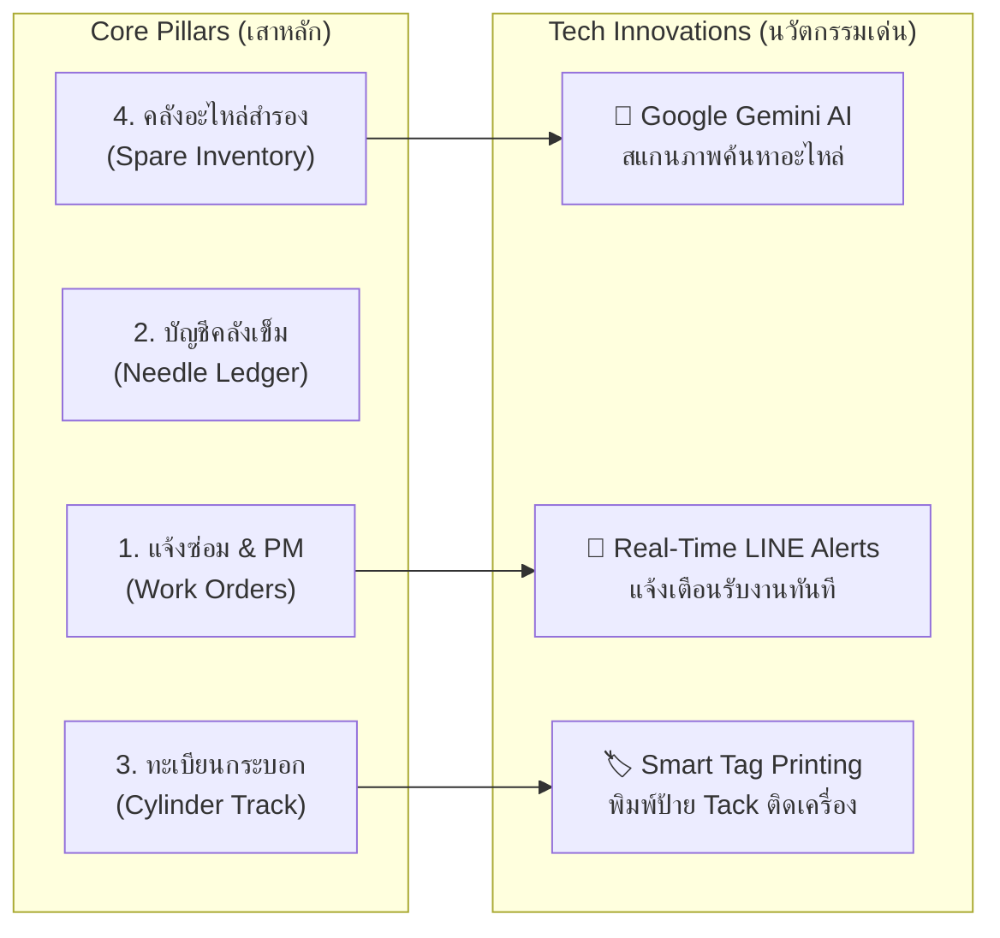

# เอกสารสรุปโครงการสำหรับผู้บริหาร (Executive One-Pager)
### โครงการพัฒนาระบบบริหารจัดการงานซ่อมบำรุงและเครื่องจักรอัจฉริยะ (TextileOps CMMS)
**บริษัท เจมม่า นิตส์ จำกัด (Gemma Knits Co., Ltd.)** | *เวอร์ชัน: v1.3.185 (Production Release)*

---

```
╔══════════════════════════════════════════════════════════════════════════════════════════════╗
║ 📌 สรุปย่อสำหรับผู้บริหาร (Executive Summary):                                              ║
║ TextileOps CMMS เป็นแพลตฟอร์มบริหารจัดการงานซ่อมบำรุง เครื่องจักร คลังเข็ม และอะไหล่          ║
║ ที่ออกแบบขึ้นเพื่อแก้ปัญหาการทำงานซ้ำซ้อน ลดเวลาเครื่องหยุดซ่อม (Downtime) 25-35%               ║
║ และสร้างความถูกต้องของสต็อกอะไหล่-กระบอกเข็มสู่ 99.5% ด้วยระบบคลาวด์มาตรฐานระดับโลกและ AI     ║
╚══════════════════════════════════════════════════════════════════════════════════════════════╝
```

---

## 1. ดัชนีชี้วัดความสำเร็จทางธุรกิจ (Key Value Metrics & Expected ROI)

| 📉 -30% Unplanned Downtime | ⏱️ < 1 นาที แจ้งซ่อม | 🎯 99.5% สต็อกแม่นยำ | 🔍 100% ตรวจสอบย้อนหลังได้ |
| :---: | :---: | :---: | :---: |
| ลดการสูญเสียกำลังการผลิตจากเครื่องจักรหยุดนิ่ง คิดเป็นเวลาเดินงานเพิ่มขึ้นหลายร้อยชั่วโมง/เดือน | ช่างรับแจ้งเตือนผ่าน LINE ทันที เครื่องไม่ต้องจอดคอยช่างเหมือนระบบเดิม | ป้องกันเข็มสูญหาย เบิกซ้ำซ้อน และอะไหล่ขาดสต็อกในจังหวะเร่งด่วน | บันทึกประวัติการเปลี่ยนกระบอกเข็ม การซ่อม และอะไหล่รายเครื่องครบถ้วน |

---

## 2. การเปรียบเทียบกระบวนการทำงาน (Before vs After Matrix)

| มิติการทำงาน | กระบวนการเดิม (Before TextileOps) | ระบบใหม่ (With TextileOps CMMS) | ผลประโยชน์ที่โรงงานได้รับ |
| :--- | :--- | :--- | :--- |
| **การแจ้งซ่อม** | เดินบอกด้วยวาจา / เขียนเศษกระดาษ ช่างไม่ทราบทันที | สแกน QR แจ้งซ่อมผ่านมือถือใน 30 วินาที ข้อความเด้งเข้า LINE | ลดเวลาตอบสนองช่างลงกว่า 80% |
| **คลังเข็ม & มิเตอร์** | บันทึกใส่สมุด ไม่สัมพันธ์กับรอบเครื่องจักรจริง | ระบบ **Needle Ledger** จับคู่เบิกเข็มกับรอบมิเตอร์เครื่อง | ควบคุมต้นทุนเข็ม ป้องกันสูญหาย |
| **การค้นหาอะไหล่** | เดินค้นหาตามความจำ เสียเวลา 15-20 นาทีต่อครั้ง | ใช้ **Google Gemini AI Vision** ถ่ายรูปค้นหาใน 5 วินาที | แม้ช่างใหม่ก็หยิบอะไหล่ถูกต้อง |
| **ป้ายระบุสเปกกระบอก** | เขียนกระดาษกาวแปะ หลุดหาย สเปกไม่ตรง | พิมพ์ **Smart Tag (20×7cm & A4)** สีเขียวเด่นชัดจากระบบ | ขจัดปัญหาผ้าเสียจากการใส่กระบอกผิด |
| **รายงานผู้บริหาร** | ต้องรอรวมเล่มรายสัปดาห์ ไม่ทันต่อเหตุการณ์ | **Executive Real-Time Dashboard** เปิดดูได้ทุกที่ 24 ชม. | ตัดสินใจเชิงรุกได้ทันท่วงที |

---

## 3. สี่เสาหลักและนวัตกรรมทางเทคโนโลยี (Core Pillars & Innovation Highlights)



- **สถาปัตยกรรมระบบ (Architecture)**: ทำงานบน **Cloudflare Global Edge** ร่วมกับ **Supabase Database** 
- **ความปลอดภัยและเสถียรภาพ**: เข้ารหัสข้อมูลระดับ HTTPS/SSL มีการแบ่งสิทธิ์ (RBAC: Admin, Supervisor, Tech, Viewer)
- **ความยืดหยุ่นหน้างาน (Offline-First PWA)**: ช่างติดตั้งลงหน้าจอมือถือได้ทันที ใช้งานลื่นไหลและบันทึกข้อมูลได้แม้ในจุดที่สัญญาณเน็ตอ่อน

---

## 4. สถานะโครงการและก้าวต่อไป (Project Status & Next Horizon)

- **สถานะปัจจุบัน**: ผ่านการทดสอบคุณภาพระบบระดับเข้มข้น 100% (**87 Test Suites / 736 Automated Tests**) พร้อมใช้งานจริงบน Production Domain: `https://textileops-cmms.pages.dev`
- **ระยะเวลาการคืนทุนที่คาดการณ์ (Payback Period)**: **ต่ำกว่า 3 เดือน** (จากมูลค่าผ้าที่ไม่เสียหายและเวลาช่างที่ประหยัดได้)
- **แผนงานเฟสถัดไป (Next Phase)**: เชื่อมต่อเซ็นเซอร์รอบเครื่องจักรอัตโนมัติ (IoT), เชื่อมต่อ API บัญชี ERP, และพัฒนาระบบบำรุงรักษาเชิงพยากรณ์ (Predictive Maintenance AI)

---

```
┌──────────────────────────────────────────────────────────────────────────────────────────────┐
│                               การรับรองและอนุมัติโครงการ                                    │
│                                                                                              │
│   ผู้เสนอโครงการ: .......................................  วันที่: ..... / ..... / 2026      │
│                  (ทีมพัฒนาระบบ TextileOps)                                                   │
│                                                                                              │
│   ผู้อนุมัติโครงการ: ....................................... วันที่: ..... / ..... / 2026      │
│                  (คณะผู้บริหารระดับสูง บริษัท เจมม่า นิตส์ จำกัด)                              │
└──────────────────────────────────────────────────────────────────────────────────────────────┘
```
